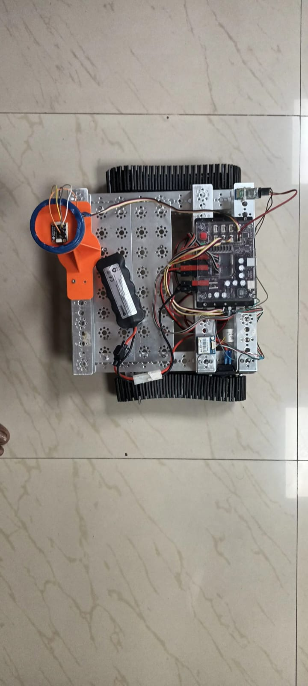
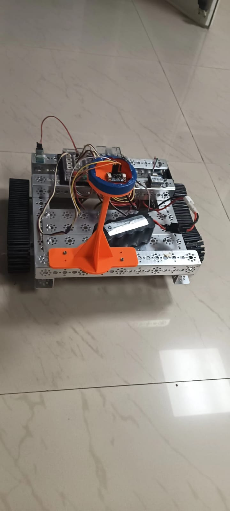
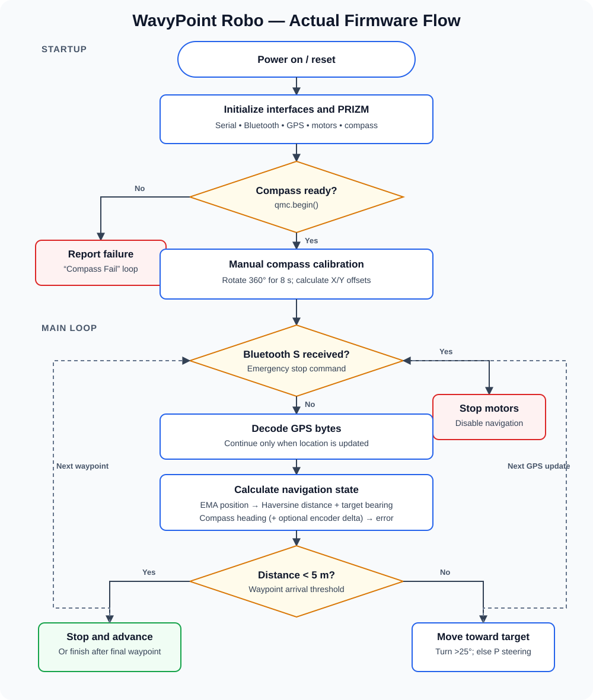

# WavyPoint Robo

Autonomous GPS waypoint navigation for a differential-drive robot built with a PRIZM controller, QMC5883P compass, u-blox GPS, and HC-05 Bluetooth module.

The firmware smooths GPS fixes, calculates the distance and bearing to each waypoint, and uses compass feedback to turn or steer toward the target. It advances through the waypoint list automatically and streams status over Bluetooth.

## Robot build

<table>
  <tr>
    <td align="center"></td>
    <td align="center"></td>
  </tr>
  <tr>
    <td align="center"><em>Top view</em></td>
    <td align="center"><em>Front perspective</em></td>
  </tr>
</table>

## Features

- Haversine distance and initial-bearing calculations
- Exponential smoothing for noisy GPS positions
- Eight-second hard-iron compass calibration at startup
- Turn-in-place and proportional forward steering modes
- Optional encoder-assisted heading between compass samples
- Bluetooth telemetry and emergency stop command
- Automatic waypoint advance and final stop

## Navigation flow



An accessible step-by-step version is available in [docs/flowchart-text.md](docs/flowchart-text.md).

## Hardware

| Component | Role |
|---|---|
| PRIZM controller | Main compute and motor control |
| QMC5883P compass | Robot heading |
| u-blox GPS | Position fixes |
| Two DC motors | Differential drive |
| HC-05 Bluetooth module | Telemetry and stop command at 9600 baud |
| Motor encoders | Optional heading estimation between compass reads |

### Pin assignments

| Connection | Pins |
|---|---|
| HC-05 Bluetooth RX/TX | 2, 9 |
| GPS RX/TX | 3, 4 |
| Left/right motors | PRIZM ports 1, 2 |
| Compass | I2C |

> Verify voltage levels and wiring against the documentation for your exact modules before powering the robot.

## Setup

1. Clone or download this repository.
2. Open `wavy.c` in the Arduino IDE. If the IDE requires an Arduino sketch layout, copy it to `WavyPointRobo/WavyPointRobo.ino`.
3. Install the PRIZM, `Adafruit QMC5883P`, and `TinyGPSPlus` libraries. `Wire` and `SoftwareSerial` are included with the Arduino toolchain.
4. Edit the waypoints and hardware-specific settings described below.
5. Compile and upload the firmware to the PRIZM-compatible board.
6. Place the robot in a safe, open area and power it on.
7. When Bluetooth prints `CALIBRATING: Spin Robot 360 deg NOW!`, rotate the robot through a full circle for eight seconds. Navigation begins after a valid GPS update.

## Configuration

Edit the constants near the top of [`wavy.c`](wavy.c):

```cpp
const float COMPASS_OFFSET = 0;
const bool PURE_COMPASS_MODE = true;
float declinationDeg = -0.6;

const int CRUISE_SPEED = 50;
const int TURN_SPEED = 45;
const int MIN_MOTOR_POWER = 25;
```

Replace the sample coordinates before operating the robot:

```cpp
NavPoint waypoints[] = {
  {17.780223, 83.375458},
  {17.780277, 83.375477},
  {17.780322, 83.375368},
  {17.780305, 83.375359}
};
```

`PURE_COMPASS_MODE` is enabled by default. Setting it to `false` enables encoder-based heading changes between compass updates; verify encoder direction and wheel geometry first.

## Bluetooth output and control

Typical telemetry:

```text
Hdg:45 Tgt:42 Err:-3 Dist:12.5
Reached WP 0
Done!
```

| Field | Meaning |
|---|---|
| `Hdg` | Current heading in degrees |
| `Tgt` | Bearing to the active waypoint in degrees |
| `Err` | Shortest signed turn from current heading to target |
| `Dist` | Haversine distance to the active waypoint in metres |

Send `S` or `s` over Bluetooth to stop navigation. The current firmware does not provide a resume command; restart the controller to begin again.

## Safety

- Test with the drive wheels raised before the first ground run.
- Keep a physical power cutoff within reach.
- Use an open outdoor area with a clear GPS view and no people, traffic, or obstacles.
- Confirm motor direction, compass orientation, and stop control at low power.
- Sample coordinates are for demonstration only; replace them with a route you have permission to use.

## Troubleshooting

| Symptom | Check |
|---|---|
| `Compass Fail` repeats | I2C wiring, sensor power, address, and library compatibility |
| No movement after calibration | GPS baud rate, antenna sky view, and whether location updates are arriving |
| Robot turns the wrong way | Compass orientation, `INVERT_COMPASS`, motor wiring, and right-motor inversion |
| Robot oscillates around the target heading | Reduce the proportional gain in `executeMovement()` or lower motor power |
| Arrival triggers too early or late | Adjust the `5.0` metre threshold in `loop()` for GPS accuracy |
| Encoder-assisted mode drifts | Verify encoder polarity, `TICKS_PER_REV`, wheel radius, and wheel base |

## Project structure

```text
.
|-- wavy.c                         # Arduino-compatible firmware
|-- assets/flowchart.svg           # Authoritative navigation diagram
|-- assets/robot-top-view.png      # Assembled robot, top view
|-- assets/robot-front-view.png    # Assembled robot, front perspective
|-- docs/flowchart-text.md         # Accessible diagram walkthrough
|-- CONTRIBUTING.md
`-- .github/                       # Issue and pull-request templates
```

## Contributing

Issues and pull requests are welcome. See [CONTRIBUTING.md](CONTRIBUTING.md) for the expected test notes and hardware details.
